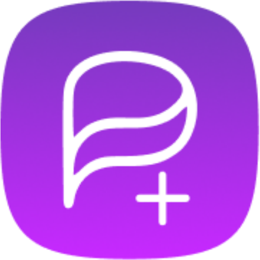

<div align="center">
  

  <h1>Planeja+ para Claude Code e Cowork</h1>

  <p>Plugin e marketplace público do conector MCP do <a href="https://planejamais.planejareconsultoria.com.br">Planeja+</a>: planejamento estratégico, tarefas Kanban, reuniões, relatórios, tickets e editais e projetos no Claude.</p>

  <p>
    <a href="https://github.com/hendrykcosta75/planejamais-claude-plugin/releases/latest"></a>
    <a href="LICENSE"></a>
    <a href="https://registry.modelcontextprotocol.io/v0/servers?search=io.github.hendrykcosta75/planejamais"></a>
    <a href="https://mcptry.com/servers/io.github.hendrykcosta75/planejamais"></a>
  </p>
  <p>
    
    <a href="https://claude.ai/directory/connectors/planejamais"></a>
    
    
  </p>
</div>

Este repositório é só o pacote de distribuição; o produto Planeja+ não é aberto e vive em outro
repositório. No claude.ai e no Claude Desktop, o mais simples é o
[conector do diretório](https://claude.ai/directory/connectors/planejamais).

## O que o plugin instala

- Servidor MCP remoto `planejamais` (`https://planejamais.planejareconsultoria.com.br/api/mcp`),
  com OAuth 2.1 conduzido pelo Claude (Dynamic Client Registration + PKCE).
- Skill `planejamais` com os fluxos de uso, o cuidado com `companyId` e as
  regras de confirmação para ações destrutivas.

Exclusões permanentes, reescritas do projeto por IA e menções que enviam e-mail
passam por uma confirmação aplicada pelo servidor: a primeira chamada devolve um
token `confirmacao` e não executa nada; só a mesma chamada repetida com o token
executa, uma vez.

Nenhum token manual é necessário: na primeira chamada o Claude abre o navegador
para o usuário autorizar, e o token pode ser removido depois em
`https://planejamais.planejareconsultoria.com.br/mcp`.

## Instalação

```bash
claude plugin marketplace add hendrykcosta75/planejamais-claude-plugin
claude plugin install planejamais@planejamais
```

Ou, dentro do Claude Code, use `/plugin`, escolha o marketplace `planejamais` e
instale o plugin. Para testar localmente:

```bash
claude plugin validate ./plugins/planejamais --strict
claude --plugin-dir ./plugins/planejamais
```

## Publicação no diretório

A submissão é feita no portal de desenvolvedores do claude.ai
(`https://claude.ai/directory/manage`) como **Plugin bundle**, com o caminho
`plugins/planejamais`. Antes de enviar, rode:

```bash
claude plugin validate ./plugins/planejamais --profile directory
```

O README e o LICENSE exibidos na listagem ficam dentro de `plugins/planejamais`.

## Manutenção

- A URL de produção é `https://planejamais.planejareconsultoria.com.br/api/mcp`.
  Se o app mudar de domínio, atualize `plugins/planejamais/.mcp.json` e suba a versão.
- Ao publicar uma nova versão, incremente `version` em
  `plugins/planejamais/.claude-plugin/plugin.json` e no marketplace.
